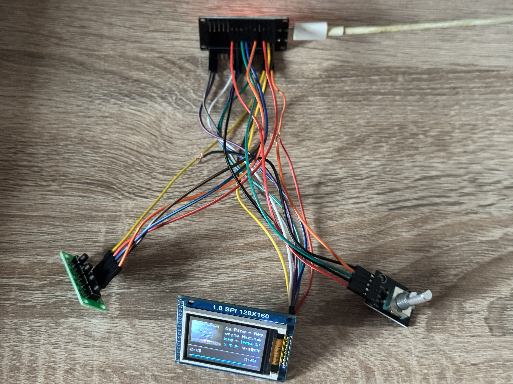
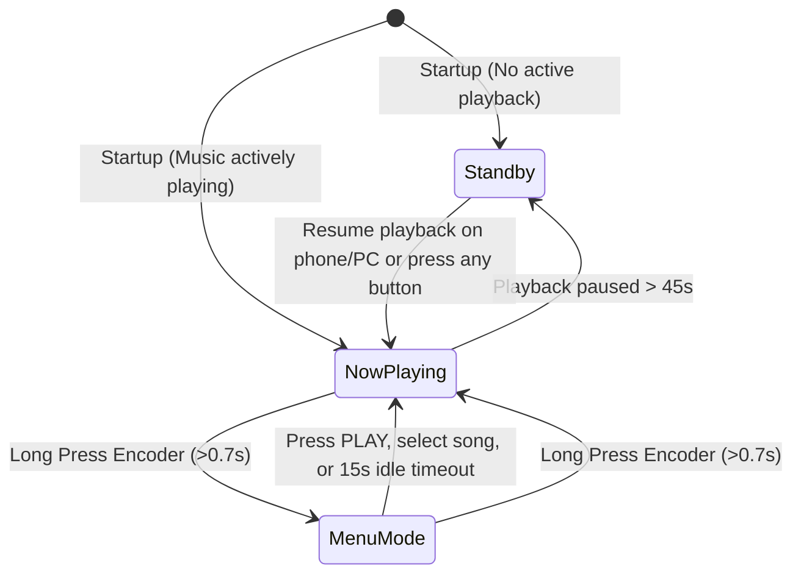
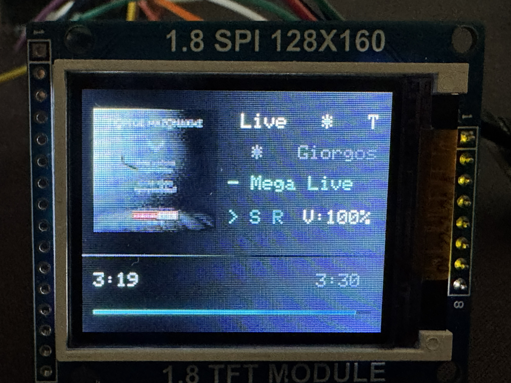
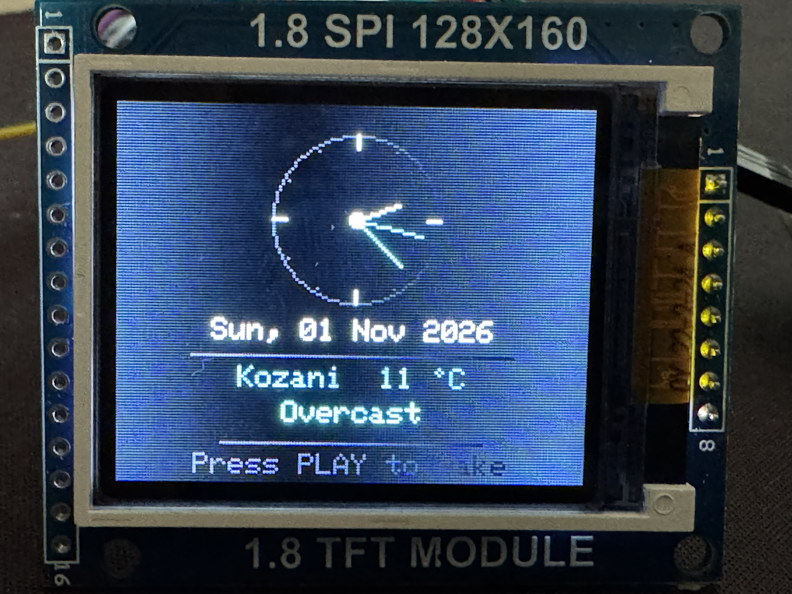

# 🎵 ESP32 Spotify Smart Hub & Clock — User Manual

Complete operations, wiring, and configuration manual for the **ESP32 Spotify Smart Hub**.

---

## 📑 Table of Contents
1. [Features & Specifications](#1-features--specifications)
2. [Wiring & Pinout (Hardware)](#2-wiring--pinout-hardware)
3. [The 3 Operating Modes](#3-the-3-operating-modes)
   - [Mode 1: Now Playing (Music Playback)](#mode-1-now-playing-music-playback)
   - [Mode 2: Menu Mode (Queue & Playlists)](#mode-2-menu-mode-queue--playlists)
   - [Mode 3: Standby / Screensaver (Clock & Weather)](#mode-3-standby--screensaver-clock--weather)
4. [Master Controls Cheatsheet](#4-master-controls-cheatsheet)
5. [Spotify for Developers Setup & Scopes](#5-spotify-for-developers-setup--scopes)
6. [Firmware Configuration](#6-firmware-configuration)
7. [Troubleshooting Guide](#7-troubleshooting-guide)

---

## 1. Features & Specifications

* **Microcontroller:** ESP32 NodeMCU (30-pin) with built-in Wi-Fi & Bluetooth.
* **Display:** 1.8" SPI TFT (ST7735 controller), 160x128 resolution, 65K colors (RGB565).
* **Physical Controls:** 
  * Rotary Encoder with integrated push-button switch (KY-040 / EC11).
  * 4-Bit tactile button module (independent switches).
* **Network & Cloud Features:**
  * Direct communication with the official **Spotify Web API** over HTTPS.
  * Real-time JPEG streaming and decompression of 64x64 album cover art (`TJpg_Decoder`).
  * Automatic network time synchronization via **NTP** with timezone support.
  * City geolocation and live weather/temperature reporting via **Open-Meteo API** (no API key required).

---

## 2. Wiring & Pinout (Hardware)

<p align="center">
  
</p>

### A. 1.8" ST7735 SPI TFT Display (160x128)
| Display Pin | Label | ESP32 GPIO | Description |
|---|---|---|---|
| Pin 1 | **RST** | **GPIO 22** | Display Hardware Reset |
| Pin 2 | **CS** | **GPIO 5** | SPI Chip Select |
| Pin 3 | **D/C (A0)** | **GPIO 4** | Data / Command Control |
| Pin 4 | **DIN (SDA)** | **GPIO 23** | Hardware VSPI MOSI (Data) |
| Pin 5 | **CLK (SCK)** | **GPIO 18** | Hardware VSPI SCK (Clock) |
| Pin 6 | **VCC** | **3.3V or 5V** | Power Supply |
| Pin 7 | **BL (LED)** | **3.3V** | Backlight Power |
| Pin 8 | **GND** | **GND** | Common Ground |

### B. EC11 / KY-040 Rotary Encoder
| Encoder Pin | Label | ESP32 GPIO | Description |
|---|---|---|---|
| CLK | **CLK (A)** | **GPIO 32** | Quadrature Phase A (Interrupt pin) |
| DT | **DT (B)** | **GPIO 33** | Quadrature Phase B |
| SW | **SW** | **GPIO 25** | Push-button Switch |
| + | **VCC** | **3.3V** | Power Supply |
| GND | **GND** | **GND** | Common Ground |

### C. 4-Bit Key Button Module
| Key Pin | ESP32 GPIO | Default Action |
|---|---|---|
| **K1** | **GPIO 26** | **PREV** (Short click: Previous Track \| Long press: Restart Track from 0:00) |
| **K2** | **GPIO 27** | **PLAY** (Toggle Play/Pause \| Back in Menu \| Screensaver Wake-up) |
| **K3** | **GPIO 14** | **NEXT** (Next Track \| Scroll down) |
| **K4** | **GPIO 13** | **SHUF / REPEAT** (Short click: Shuffle toggle \| Long press: Repeat mode) |
| **GND** | **GND** | Common Ground (Active LOW with internal Pull-Up) |

---

## 3. The 3 Operating Modes



---

### Mode 1: Now Playing (Music Playback)

Automatically activates whenever a song is actively playing on your Spotify account.

<p align="center">
  
</p>

```text
┌────────────────────────────────────────┐
│  ┌──────┐  Track Title (Marquee)       │
│  │      │  Artist Name (Gray)          │
│  │ 64x64│  Album Name (Cyan)           │
│  │  Art │                              │
│  └──────┘  >  S  R1     V:65%          │
├────────────────────────────────────────┤
│ 1:24                            3:45   │
│ ▬▬▬▬▬▬▬▬▬▬▬▬▬──────────────────────────│
└────────────────────────────────────────┘
```

1. **Album Art (64x64):** Downloaded directly from Spotify's CDN servers in JPEG format and rendered inside the left border box.
2. **Scrolling Text (RDS / Marquee):** 
   * Song Title (White).
   * Artist Name (Light Gray).
   * Album Name (Cyan).
   * Any text exceeding 13 characters scrolls smoothly every 600ms.
3. **Status Indicators:**
   * `>` = Playing, `||` = Paused.
   * `S` = Shuffle active.
   * `R` = Context/Playlist Repeat, `R1` = Single Track Repeat.
   * `V:xx%` = Current Spotify volume level.
4. **Progress Bar & Timers:**
   * Green progress bar (148 pixels wide).
   * Elapsed time (left) and total duration (right) formatted as `M:SS`.

---

### Mode 2: Menu Mode (Queue & Playlists)

Allows you to browse upcoming tracks and choose playlists directly from the hardware without opening your phone or computer.

#### Access & Navigation
* **Enter:** Hold down the Rotary Encoder button (`ENC_SW`) for **>= 0.7 seconds** and release.
* **Navigate:** Turn the encoder clockwise/counter-clockwise to move the green cursor `>`.
* **Select:** Single click the rotary encoder button.

#### Menu Structure:
```text
           MENU                        QUEUE - Next Up                    PLAYLISTS
  ─────────────────────────      ─────────────────────────      ─────────────────────────
  > Queue (Next Up)              > Artist 1 - Track A           > Discover Weekly
    Playlists                      Artist 2 - Track B             Daily Mix 1
                                   Artist 3 - Track C             Rock Classics
                                   Artist 4 - Track D             Chill Lofi Beats
  ─────────────────────────      ─────────────────────────      ─────────────────────────
    Rotate + Click=Select          Click=Play  PLAY=Back          Click=Play  PLAY=Back
```

* **Queue (Next Up):** Shows up to 25 upcoming tracks waiting in your playback queue. Clicking any song immediately skips to that track without clearing your active queue or context!
* **Playlists:** Displays up to 25 playlists from your user library (with visual scrollbar). Clicking a playlist initiates immediate playback of that playlist!
* **Item Marquee Scrolling:** The currently selected item with the `>` cursor scrolls automatically if its title exceeds 23 characters, ensuring full readability of long names.
* **Back:** Press **K1 (PREV)** to go back to the previous menu level.
* **Exit:** Press **K2 (PLAY)** or hold the encoder button to immediately return to the Now Playing screen (also automatically exits after 15 seconds of inactivity).

---

### Mode 3: Standby / Screensaver (Clock & Weather)

Automatically activates when playback has been paused for **45 seconds** or when the Spotify app is closed.

<p align="center">
  
</p>

```text
┌────────────────────────────────────────┐
│                   12                   │
│               \        /               │
│            9   \  ●───   3             │
│                 \                      │
│                   6                    │
│                                        │
│            Sat, 31 Oct 2026            │
│       ──────────────────────────       │
│              Kozani  12 °C             │
│                Overcast                │
│       ──────────────────────────       │
│           Press PLAY to wake           │
└────────────────────────────────────────┘
```

1. **Zero-Flicker Analog Clock:**
   * Circular dial with 12 hour tick marks (accented markers at 12, 3, 6, 9).
   * **Hour Hand:** White (`UI_WHITE`).
   * **Minute Hand:** Cyan (`UI_CYAN`).
   * **Second Hand:** Spotify Green (`UI_GREEN`).
   * Efficiently erases only previous hand positions every second, providing flicker-free movement.
2. **Current Date:** Accurate calendar date synchronized via NTP internet servers.
3. **Location & Temperature:** Displays your configured city and real-time temperature in Spotify Green (e.g. `Kozani  12 °C`).
4. **Weather Condition:** Textual description of current weather (e.g. `Clear Sky`, `Partly Cloudy`, `Overcast`, `Light Drizzle`, `Rainy`).
5. **Wake-up Mechanisms:**
   * **Automatic:** Resuming playback from your phone, tablet, or PC wakes the ESP32 in under 3.5 seconds!
   * **Manual:** Pressing any hardware button or rotating the encoder.

---

## 4. Master Controls Cheatsheet

| Control Input | Action | Now Playing Mode | Menu Mode | Screensaver (Standby) |
|---|---|---|---|---|
| **Rotary Encoder** | **Rotate Right** | Increase Spotify Volume (+2%) | Scroll Down (`>`) | Wake up & increase volume |
| **Rotary Encoder** | **Rotate Left** | Decrease Spotify Volume (-2%) | Scroll Up (`>`) | Wake up & decrease volume |
| **Encoder Button (ENC_SW)** | **Short Click (<0.7s)** | **Mute / Unmute** (Restores volume) | **Select / Play item** | Wake up display |
| **Encoder Button (ENC_SW)** | **Long Press (>=0.7s)** | **Open Menu** (Queue/Playlists) | **Exit Menu** to playback | Wake up display |
| **Button K1 (PREV)** | **Short Click (<0.5s)** | Skip to Previous Track | Back to parent menu | Wake up & Previous track |
| **Button K1 (PREV)** | **Long Press (>=0.5s)** | **Restart Song from 0:00** | — | Wake up & Restart track |
| **Button K2 (PLAY)** | **Click** | **Play / Pause** toggle | **Exit** to Now Playing | Wake up & Play |
| **Button K3 (NEXT)** | **Click** | Skip to Next Track | Scroll Down | Wake up & Next track |
| **Button K4 (SHUF)** | **Short Click (<0.5s)** | **Shuffle** On / Off | — | Wake up & Shuffle |
| **Button K4 (SHUF)** | **Long Press (>=0.5s)** | **Repeat**: Off ➔ Context (`R`) ➔ Track (`R1`) | — | Wake up & Repeat |

---

## 5. Spotify for Developers Setup & Scopes

To enable queue browsing and playlist playback, your Spotify Developer App must be configured with appropriate OAuth permission scopes.

### A. Dashboard Setup
1. Log in to the [Spotify Developer Dashboard](https://developer.spotify.com/dashboard).
2. Open your registered App and click **Settings**.
3. Under **Redirect URIs**, add: `http://localhost:8888/callback` and click **Save**.

### B. Required Scopes List
* `user-read-playback-state` (Read playback state & queue)
* `user-modify-playback-state` (Control playback: play, pause, volume, seek, next/prev)
* `user-read-currently-playing` (Read current track & album art URL)
* `playlist-read-private` (Read user's private playlists)
* `playlist-read-collaborative` (Read collaborative playlists)

### C. Generating a New Refresh Token (2 Steps)

#### Step 1: Authorization in Browser
Paste the following URL into your web browser, replacing `YOUR_CLIENT_ID` with your actual Client ID:
```text
https://accounts.spotify.com/authorize?client_id=YOUR_CLIENT_ID&response_type=code&redirect_uri=http://localhost:8888/callback&scope=user-read-playback-state%20user-modify-playback-state%20user-read-currently-playing%20playlist-read-private%20playlist-read-collaborative
```
Click **Agree**. The browser will redirect to an address starting with:
`http://localhost:8888/callback?code=AQD...`
**Copy the code** value after `code=`.

#### Step 2: Request Token via PowerShell
Open PowerShell on your computer and run:
```powershell
$clientId = "YOUR_CLIENT_ID"
$clientSecret = "YOUR_CLIENT_SECRET"
$authCode = "PASTE_THE_CODE_FROM_STEP_1_HERE"
$redirectUri = "http://localhost:8888/callback"

$authHeader = [Convert]::ToBase64String([System.Text.Encoding]::UTF8.GetBytes("$($clientId):$($clientSecret)"))

$response = Invoke-RestMethod -Uri "https://accounts.spotify.com/api/token" -Method POST -Headers @{
    "Authorization" = "Basic $authHeader"
    "Content-Type"  = "application/x-www-form-urlencoded"
} -Body @{
    "grant_type"   = "authorization_code"
    "code"         = $authCode
    "redirect_uri" = $redirectUri
}

$response.refresh_token
```
Copy the long string returned and set it as `SECRET_REFRESH_TOKEN` in your `secrets.h` file!

---

## 6. Firmware Configuration

All user credentials and personal preferences are managed inside `secrets.h` (created from `secrets.h.example`):

```cpp
#define SECRET_WIFI_SSID     "YOUR_WIFI_SSID"
#define SECRET_WIFI_PASSWORD "YOUR_WIFI_PASSWORD"

#define SECRET_CLIENT_ID     "YOUR_SPOTIFY_CLIENT_ID"
#define SECRET_CLIENT_SECRET "YOUR_SPOTIFY_CLIENT_SECRET"
#define SECRET_REFRESH_TOKEN "YOUR_SPOTIFY_REFRESH_TOKEN"

#define SECRET_CITY_NAME     "Athens" // E.g., "London", "New York" or leave "" for IP geolocation
```

---

## 7. Troubleshooting Guide

### ❌ Arduino IDE Upload Failure (`COM port busy or doesn't exist / Code 43`)
* **Cause:** USB connection reset or voltage drop on the CH340 / CP2102 chip.
* **Fix:** Unplug the USB cable from your computer, wait 3 seconds, and reconnect (preferably to a motherboard rear USB port). Confirm the correct port in `Tools -> Port`.

### ❌ Menu shows `Scope Error: Token`
* **Cause:** The Refresh Token in use was created without queue or playlist permissions.
* **Fix:** Re-run [Section 5](#5-spotify-for-developers-setup--scopes) to obtain a new token with all required scopes.

### ❌ Display is blank or stays all white
* **Cause:** Poor wiring connection on the SPI bus or missing backlight power.
* **Fix:** Ensure the `BL` (Backlight) pin is firmly connected to 3.3V, and check `CLK` (GPIO 18) and `DIN` (GPIO 23) jumper cables.

### ❌ Weather shows the wrong city or temperature
* **Cause:** When `SECRET_CITY_NAME` is left empty `""`, IP-based geolocation can route through your ISP's regional gateway city.
* **Fix:** Define your city explicitly in `secrets.h`: `#define SECRET_CITY_NAME "YourCity"`. The ESP32 will automatically fetch exact coordinates using Open-Meteo Geocoding.
