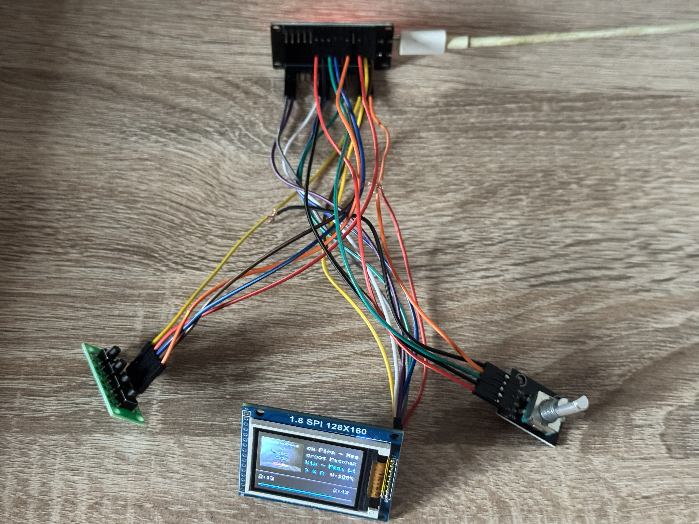
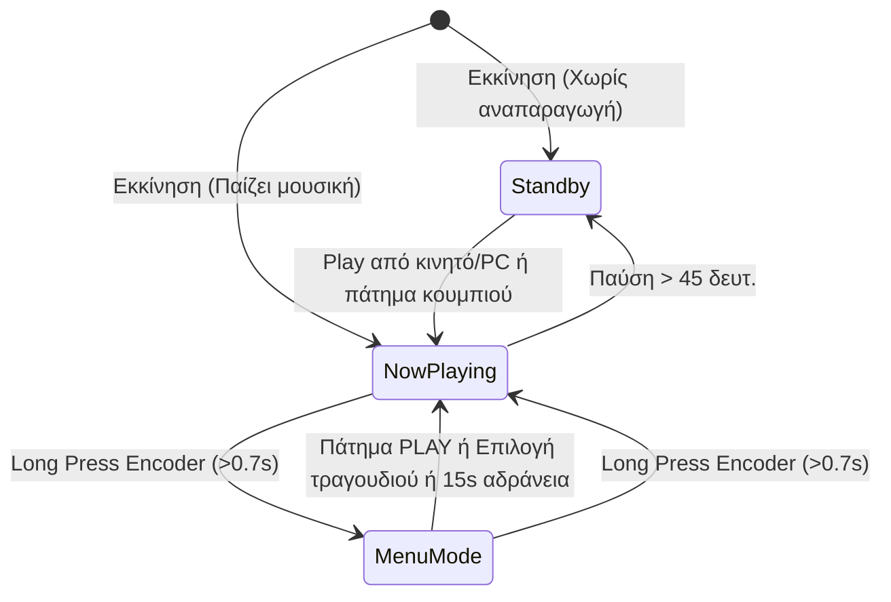
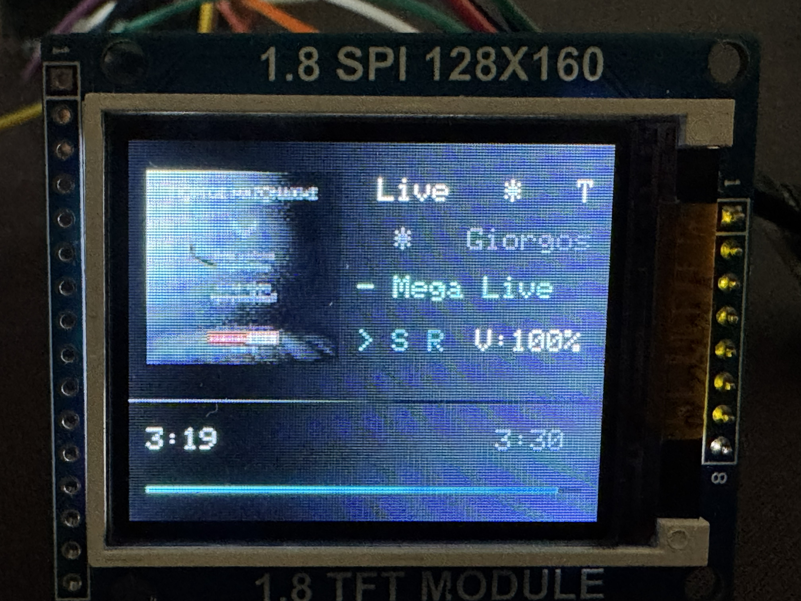
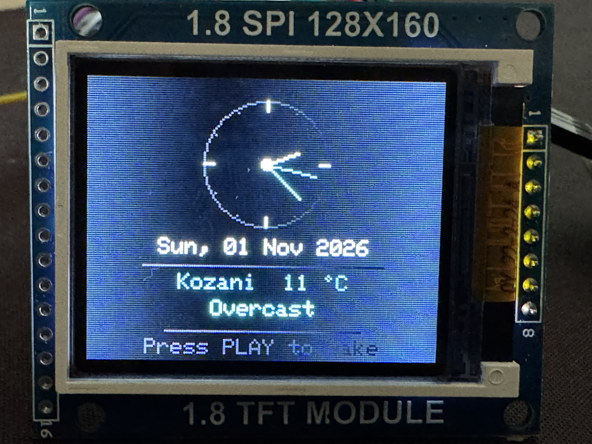

# 🎵 ESP32 Spotify Smart Hub & Clock — Εγχειρίδιο Χρήσης (Manual)

Πλήρες εγχειρίδιο λειτουργίας, συνδεσμολογίας και παραμετροποίησης για το **ESP32 Spotify Hub**.

---

## 📑 Πίνακας Περιεχομένων
1. [Χαρακτηριστικά & Προδιαγραφές](#1-χαρακτηριστικά--προδιαγραφές)
2. [Συνδεσμολογία & Pinout (Hardware)](#2-συνδεσμολογία--pinout-hardware)
3. [Οι 3 Καταστάσεις Λειτουργίας (Modes)](#3-οι-3-καταστάσεις-λειτουργίας-modes)
   - [Κατάσταση 1: Now Playing (Αναπαραγωγή Μουσικής)](#κατάσταση-1-now-playing-αναπαραγωγή-μουσικής)
   - [Κατάσταση 2: Menu Mode (Ουρά & Playlists)](#κατάσταση-2-menu-mode-ουρά--playlists)
   - [Κατάσταση 3: Standby / Screensaver (Ρολόι & Καιρός)](#κατάσταση-3-standby--screensaver-ρολόι--καιρός)
4. [Πλήρης Πίνακας Χειριστηρίων (Master Cheatsheet)](#4-πλήρης-πίνακας-χειριστηρίων-master-cheatsheet)
5. [Ρύθμιση Spotify for Developers & Scopes](#5-ρύθμιση-spotify-for-developers--scopes)
6. [Παραμετροποίηση Κώδικα (Configuration)](#6-παραμετροποίηση-κώδικα-configuration)
7. [Αντιμετώπιση Προβλημάτων (Troubleshooting)](#7-αντιμετώπιση-προβλημάτων-troubleshooting)

---

## 1. Χαρακτηριστικά & Προδιαγραφές

* **Μικροελεγκτής:** ESP32 NodeMCU (30-pin) με ενσωματωμένο Wi-Fi & Bluetooth.
* **Οθόνη:** 1.8" TFT SPI (ST7735), ανάλυση 160x128 pixels, 65K χρώματα RGB565.
* **Χειρισμός:** 
  * Περιστροφικός κωδικοποιητής (Rotary Encoder) με ενσωματωμένο διακόπτη (KY-040).
  * Μονάδα 4 ανεξάρτητων πλήκτρων (4-Bit Tactile Button Module).
* **Δικτυακές Λειτουργίες:**
  * Απευθείας επικοινωνία με το επίσημο **Spotify Web API** μέσω HTTPS.
  * Αυτόματη λήψη και αποκωδικοποίηση εξωφύλλων άλμπουμ σε πραγματικό χρόνο (JPEG 64x64).
  * Συγχρονισμός ώρας δικτύου μέσω πρωτοκόλλου **NTP** με αυτόματη αλλαγή θερινής/χειμερινής ώρας (Ελλάδα - EET/EEST).
  * Αυτόματος εντοπισμός συντεταγμένων πόλης μέσω **Open-Meteo Geocoding** και ανάκτηση ζωντανού καιρού/θερμοκρασίας.

---

## 2. Συνδεσμολογία & Pinout (Hardware)

<p align="center">
  
</p>

### Α. Οθόνη TFT 1.8" ST7735 (160x128)
| Pin Οθόνης | Όνομα | Σύνδεση στο ESP32 | Περιγραφή |
|---|---|---|---|
| Pin 1 | **RST** | **GPIO 22** | Reset οθόνης |
| Pin 2 | **CS** | **GPIO 5** | Chip Select |
| Pin 3 | **D/C (A0)** | **GPIO 4** | Data / Command control |
| Pin 4 | **DIN (SDA)** | **GPIO 23** | Hardware VSPI MOSI (Data) |
| Pin 5 | **CLK (SCK)** | **GPIO 18** | Hardware VSPI SCK (Clock) |
| Pin 6 | **VCC** | **3.3V ή 5V** | Τροφοδοσία |
| Pin 7 | **BL (LED)** | **3.3V** | Backlight οθόνης |
| Pin 8 | **GND** | **GND** | Γείωση |

### Β. Rotary Encoder (KY-040)
| Pin Encoder | Όνομα | Σύνδεση στο ESP32 | Περιγραφή |
|---|---|---|---|
| CLK | **CLK** | **GPIO 32** | Σήμα Α περιστροφής (Interrupt) |
| DT | **DT** | **GPIO 33** | Σήμα Β περιστροφής |
| SW | **SW** | **GPIO 25** | Ενσωματωμένο κουμπί (Push switch) |
| + | **VCC** | **3.3V** | Τροφοδοσία |
| GND | **GND** | **GND** | Γείωση |

### Γ. Μονάδα 4 Πλήκτρων (4-Button Module)
| Πλήκτρο | Σύνδεση στο ESP32 | Λειτουργία |
|---|---|---|
| **K1** | **GPIO 26** | **PREV** (Προηγούμενο κομμάτι / Πίσω στο μενού) |
| **K2** | **GPIO 27** | **PLAY** (Play / Pause / Έξοδος από μενού) |
| **K3** | **GPIO 14** | **NEXT** (Επόμενο κομμάτι / Scroll κάτω) |
| **K4** | **GPIO 13** | **SHUF / REPEAT** (Shuffle & Repeat toggle) |
| **GND** | **GND** | Κοινή γείωση πλήκτρων (Active LOW με εσωτερικό Pull-Up) |

---

## 3. Οι 3 Καταστάσεις Λειτουργίας (Modes)



---

### Κατάσταση 1: Now Playing (Αναπαραγωγή Μουσικής)

Ενεργοποιείται αυτόματα όταν παίζει οποιοδήποτε τραγούδι στο Spotify.

<p align="center">
  
</p>

```
┌────────────────────────────────────────┐
│  ┌──────┐  Τίτλος Τραγουδιού (Marquee) │
│  │      │  Καλλιτέχνης (Γκρι)          │
│  │ 64x64│  Άλμπουμ (Κυανό)             │
│  │  Art │                              │
│  └──────┘  >  S  R1     V:65%          │
├────────────────────────────────────────┤
│ 1:24                            3:45   │
│ ▬▬▬▬▬▬▬▬▬▬▬▬▬──────────────────────────│
└────────────────────────────────────────┘
```

1. **Εξώφυλλο Άλμπουμ (64x64):** Κατεβαίνει απευθείας από τους servers του Spotify σε JPEG και σχεδιάζεται αριστερά στο πλαίσιο.
2. **Κυλιόμενο Κείμενο (RDS / Marquee):** 
   * Τίτλος τραγουδιού (Λευκό).
   * Όνομα καλλιτέχνη (Ανοιχτό γκρι).
   * Όνομα άλμπουμ (Κυανό).
   * Αν το κείμενο υπερβαίνει τους 13 χαρακτήρες, κυλάει αυτόματα και ομαλά ανά 600ms.
3. **Γραμμή Κατάστασης (Status Row):**
   * `>` = Αναπαραγωγή, `||` = Παύση.
   * `S` = Shuffle ενεργό.
   * `R` = Επανάληψη λίστας, `R1` = Επανάληψη τρέχοντος κομματιού.
   * `V:xx%` = Τρέχουσα ένταση ήχου στο Spotify.
4. **Μπάρα Προόδου & Χρονόμετρα:**
   * Πράσινη γραμμή προόδου μήκους 148 pixels.
   * Χρόνος που πέρασε (αριστερά) και συνολική διάρκεια (δεξιά) σε μορφή `Λ:ΔΔ`.

---

### Κατάσταση 2: Menu Mode (Ουρά & Playlists)

Επιτρέπει την περιήγηση στα επόμενα τραγούδια και τις λίστες σου χωρίς να ανοίξεις το κινητό.

#### Είσοδος & Πλοήγηση
* **Είσοδος:** Κράτα πατημένο το κουμπί του Rotary Encoder (`ENC_SW`) για **>= 0.7 δευτερόλεπτα** και άφησέ το.
* **Πλοήγηση:** Περίστρεψε τον encoder δεξιά/αριστερά για να μετακινήσεις τον πράσινο δείκτη `>`.
* **Επιλογή:** Κάνε ένα σύντομο click στον encoder.

#### Δομή Μενού:
```
           MENU                        QUEUE - Next Up                    PLAYLISTS
  ─────────────────────────      ─────────────────────────      ─────────────────────────
  > Queue (Next Up)              > Artist 1 - Track A           > Discover Weekly
    Playlists                      Artist 2 - Track B             Daily Mix 1
                                   Artist 3 - Track C             Rock Classics
                                   Artist 4 - Track D             Chill Lofi Beats
  ─────────────────────────      ─────────────────────────      ─────────────────────────
    Rotate + Click=Select          Click=Play  PLAY=Back          Click=Play  PLAY=Back
```

* **Queue (Next Up):** Εμφανίζει έως και 25 επόμενα τραγούδια που περιμένουν στην ουρά. Κάνοντας κλικ σε ένα τραγούδι, το hub μεταπηδά άμεσα σε αυτό χωρίς να σβήνει την ενεργή λίστα ή την ουρά!
* **Playlists:** Εμφανίζει έως και 25 playlists του προφίλ σου (με scrollbar). Κάνοντας κλικ σε μια λίστα, ξεκινά άμεσα η αναπαραγωγή ολόκληρης της playlist!
* **Κύλιση Τίτλων (Marquee):** Το αντικείμενο στο οποίο βρίσκεται ο δείκτης `>` κυλάει αυτόματα οριζόντια αν ο τίτλος του υπερβαίνει τους 23 χαρακτήρες, επιτρέποντας την πλήρη ανάγνωση ολόκληρου του ονόματος του τραγουδιού ή της playlist!
* **Επιστροφή:** Πάτα **PREV (K1)** για επιστροφή στο προηγούμενο μενού.
* **Έξοδος:** Πάτα **PLAY (K2)** ή κράτα πατημένο τον encoder για άμεση επιστροφή στην αναπαραγωγή (επίσης κλείνει αυτόματα μετά από 15 δευτερόλεπτα αδράνειας).

---

### Κατάσταση 3: Standby / Screensaver (Ρολόι & Καιρός)

Ενεργοποιείται αυτόματα όταν η μουσική είναι σε παύση για **45 δευτερόλεπτα** ή όταν η εφαρμογή του Spotify είναι κλειστή.

<p align="center">
  
</p>

```
┌────────────────────────────────────────┐
│                   12                   │
│               \        /               │
│            9   \  ●───   3             │
│                 \                      │
│                   6                    │
│                                        │
│            Sat, 31 Oct 2026            │
│       ──────────────────────────       │
│              Kozani  12 °C             │
│                Overcast                │
│       ──────────────────────────       │
│           Press PLAY to wake           │
│└────────────────────────────────────────┘
```

1. **Αναλογικό Ρολόι (Zero-Flicker):**
   * Στρογγυλό καντράν με 12 χαραγμένες ενδείξεις ωρών (μεγαλύτερες στο 12, 3, 6, 9).
   * **Ωροδείκτης:** Λευκός (`UI_WHITE`).
   * **Λεπτοδείκτης:** Κυανός (`UI_CYAN`).
   * **Δευτερολεπτοδείκτης:** Πράσινος Spotify (`UI_GREEN`).
   * Ανανεώνεται κάθε δευτερόλεπτο σβήνοντας μόνο τις προηγούμενες γραμμές δεικτών, εξασφαλίζοντας απόλυτα ομαλή κίνηση χωρίς τρεμόπαιγμα της οθόνης.
2. **Ημερομηνία:** Ακριβής ημερομηνία συγχρονισμένη αυτόματα από το ίντερνετ (NTP Server) με υποστήριξη ελληνικής ώρας.
3. **Τοποθεσία & Θερμοκρασία:** Εμφάνιση της πόλης σου και της τρέχουσας θερμοκρασίας σε Spotify Green (π.χ. `Kozani  12 °C`).
4. **Συνθήκες Καιρού:** Περιγραφή καιρικής κατάστασης (π.χ. `Clear Sky`, `Partly Cloudy`, `Overcast`, `Light Drizzle`, `Rainy`).
5. **Αφύπνιση (Wake-up):**
   * **Αυτόματα:** Μόλις πατήσεις Play από το κινητό, το tablet ή το PC σου, το ESP32 το αντιλαμβάνεται σε <3.5 δευτερόλεπτα και γυρνάει αμέσως στην οθόνη του άλμπουμ!
   * **Χειροκίνητα:** Πατώντας οποιοδήποτε κουμπί ή περιστρέφοντας τον encoder.

---

## 4. Πλήρης Πίνακας Χειριστηρίων (Master Cheatsheet)

| Χειριστήριο | Ενέργεια | Στην Αναπαραγωγή (Now Playing) | Μέσα στο Μενού (Menu Mode) | Στο Screensaver (Ρολόι) |
|---|---|---|---|---|
| **Rotary Encoder** | **Περιστροφή Δεξιά** | Αύξηση έντασης Spotify (+2%) | Κύλιση προς τα κάτω (`>`) | Αφύπνιση & αύξηση έντασης |
| **Rotary Encoder** | **Περιστροφή Αριστερά** | Μείωση έντασης Spotify (-2%) | Κύλιση προς τα πάνω (`>`) | Αφύπνιση & μείωση έντασης |
| **Rotary Button (ENC_SW)** | **Σύντομο Click (<0.7s)** | **Mute / Unmute** (Επαναφορά έντασης) | **Επιλογή / Play** | Αφύπνιση |
| **Rotary Button (ENC_SW)** | **Long Press (>=0.7s)** | **Άνοιγμα Μενού** (Queue/Playlists) | **Έξοδος από Μενού** | Αφύπνιση |
| **Κουμπί K1 (PREV)** | **Σύντομο Click (<0.5s)** | Προηγούμενο κομμάτι | Πίσω στο προηγούμενο μενού | Αφύπνιση & Previous track |
| **Κουμπί K1 (PREV)** | **Long Press (>=0.5s)** | **Επανεκκίνηση τραγουδιού από την αρχή (0:00)** | — | Αφύπνιση & Restart track |
| **Κουμπί K2 (PLAY)** | **Πάτημα** | **Play / Pause** toggle | **Έξοδος** στην οθόνη τραγουδιού | Αφύπνιση & Play |
| **Κουμπί K3 (NEXT)** | **Πάτημα** | Επόμενο κομμάτι | Κύλιση προς τα κάτω | Αφύπνιση & Next track |
| **Κουμπί K4 (SHUF)** | **Σύντομο Click (<0.5s)** | **Shuffle** On / Off | — | Αφύπνιση & Shuffle |
| **Κουμπί K4 (SHUF)** | **Long Press (>=0.5s)** | **Repeat**: Off -> List (`R`) -> Track (`R1`) | — | Αφύπνιση & Repeat |

---

## 5. Ρύθμιση Spotify for Developers & Scopes

Για να μπορεί το hub να διαβάζει την ουρά αναπαραγωγής και τις λίστες, η εφαρμογή σου στο Spotify Developer Dashboard πρέπει να έχει τα κατάλληλα δικαιώματα.

### Α. Ρυθμίσεις Dashboard
1. Συνδέσου στο [Spotify Developer Dashboard](https://developer.spotify.com/dashboard).
2. Άνοιξε την εφαρμογή σου και πάτα **Settings**.
3. Στο πεδίο **Redirect URIs**, πρόσθεσε το: `http://localhost:8888/callback` και πάτα **Save**.

### Β. Λίστα Απαιτούμενων Scopes
* `user-read-playback-state` (Ανάγνωση κατάστασης & ουράς)
* `user-modify-playback-state` (Έλεγχος play, pause, έντασης, αλλαγή κομματιού)
* `user-read-currently-playing` (Ανάγνωση τρέχοντος κομματιού & εξωφύλλου)
* `playlist-read-private` (Ανάγνωση ιδιωτικών playlists)
* `playlist-read-collaborative` (Ανάγνωση συνεργατικών playlists)

### Γ. Έκδοση Νέου Refresh Token (2 Βήματα)

#### Βήμα 1: Έγκριση στον Browser
Άνοιξε στον browser τον παρακάτω σύνδεσμο αντικαθιστώντας το `YOUR_CLIENT_ID` με το Client ID σου:
```text
https://accounts.spotify.com/authorize?client_id=YOUR_CLIENT_ID&response_type=code&redirect_uri=http://localhost:8888/callback&scope=user-read-playback-state%20user-modify-playback-state%20user-read-currently-playing%20playlist-read-private%20playlist-read-collaborative
```
Πάτα **Agree**. Ο browser θα σε ανακατευθύνει σε μια διεύθυνση που ξεκινά με:
`http://localhost:8888/callback?code=AQD...`
**Αντίγραψε τον κωδικό** μετά το `code=`.

#### Βήμα 2: Λήψη Token μέσω PowerShell
Άνοιξε το PowerShell στα Windows και τρέξε:
```powershell
$clientId = "YOUR_CLIENT_ID"
$clientSecret = "YOUR_CLIENT_SECRET"
$authCode = "ΕΔΩ_ΚΑΝΕ_PASTE_ΤΟΝ_ΚΩΔΙΚΟ_ΑΠΟ_ΤΟ_ΒΗΜΑ_1"
$redirectUri = "http://localhost:8888/callback"

$authHeader = [Convert]::ToBase64String([System.Text.Encoding]::UTF8.GetBytes("$($clientId):$($clientSecret)"))

$response = Invoke-RestMethod -Uri "https://accounts.spotify.com/api/token" -Method POST -Headers @{
    "Authorization" = "Basic $authHeader"
    "Content-Type"  = "application/x-www-form-urlencoded"
} -Body @{
    "grant_type"   = "authorization_code"
    "code"         = $authCode
    "redirect_uri" = $redirectUri
}

$response.refresh_token
```
Αντίγραψε το αλφαριθμητικό που θα εμφανιστεί και βάλ' το στη μεταβλητή `REFRESH_TOKEN` στο `secrets.h`!

---

## 6. Παραμετροποίηση Κώδικα (Configuration)

Όλες οι ρυθμίσεις βρίσκονται πλέον στο αρχείο `secrets.h` (βασισμένο στο `secrets.h.example`):

```cpp
#define SECRET_WIFI_SSID     "YOUR_WIFI_SSID"
#define SECRET_WIFI_PASSWORD "YOUR_WIFI_PASSWORD"

#define SECRET_CLIENT_ID     "YOUR_SPOTIFY_CLIENT_ID"
#define SECRET_CLIENT_SECRET "YOUR_SPOTIFY_CLIENT_SECRET"
#define SECRET_REFRESH_TOKEN "YOUR_SPOTIFY_REFRESH_TOKEN"

#define SECRET_CITY_NAME     "Kozani" // π.χ. "Kozani", "Athens" ή κενό "" για IP geolocation
```

---

## 7. Αντιμετώπιση Προβλημάτων (Troubleshooting)

### ❌ Σφάλμα Upload στο Arduino IDE (`COM port busy or doesn't exist / Code 43`)
* **Αιτία:** Τα Windows έχασαν στιγμιαία την επικοινωνία με το τσιπ CH340 λόγω κουνήματος του καλωδίου USB ή πτώσης τάσης.
* **Λύση:** Αποσύνδεσε το καλώδιο USB από το PC, περίμενε 3 δευτερόλεπτα και ξανασύνδεσέ το. Βεβαιώσου στο `Tools -> Port` ότι είναι επιλεγμένο το σωστό COM port.

### ❌ Στο μενού εμφανίζεται `Scope Error: Token`
* **Αιτία:** Το Refresh Token σου εκδόθηκε χωρίς τα scopes για ανάγνωση ουράς ή playlists.
* **Λύση:** Ακολούθησε τα βήματα στην [Ενότητα 5](#5-ρύθμιση-spotify-for-developers--scopes) για να εκδώσεις νέο Token με πλήρη δικαιώματα.

### ❌ Η οθόνη δεν ανάβει ή μένει άσπρη
* **Αιτία:** Κακή επαφή στα καλώδια SPI ή ανεπαρκής τροφοδοσία.
* **Λύση:** Έλεγξε ότι το pin `BL` (Backlight) της οθόνης είναι συνδεδεμένο στα 3.3V και ότι τα pins `CLK` (D18) και `DIN` (D23) κάνουν καλή επαφή στο breadboard.

### ❌ Ο καιρός δείχνει λάθος πόλη ή θερμοκρασία
* **Αιτία:** Αν το `CITY_NAME` είναι κενό `""`, το ESP32 προσπαθεί να μαντέψει την τοποθεσία μέσω της IP του παρόχου σου.
* **Λύση:** Συμπλήρωσε την πόλη σου στο `SECRET_CITY_NAME` στο `secrets.h`. Το ESP32 θα βρει αυτόματα τις ακριβείς συντεταγμένες μέσω Open-Meteo Geocoding.
