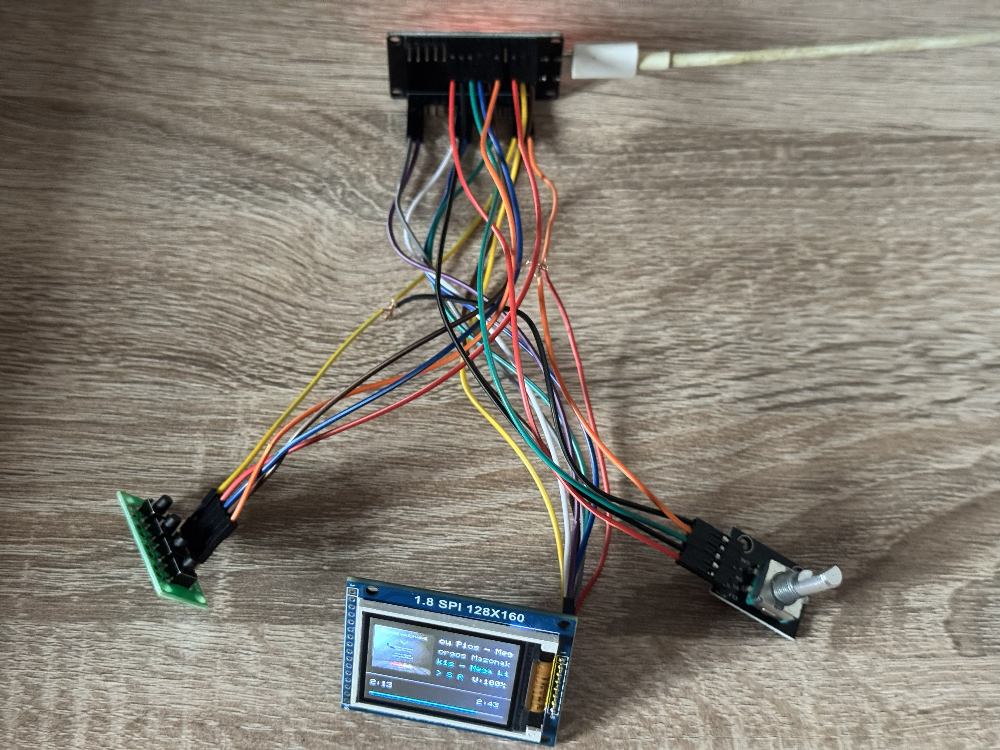
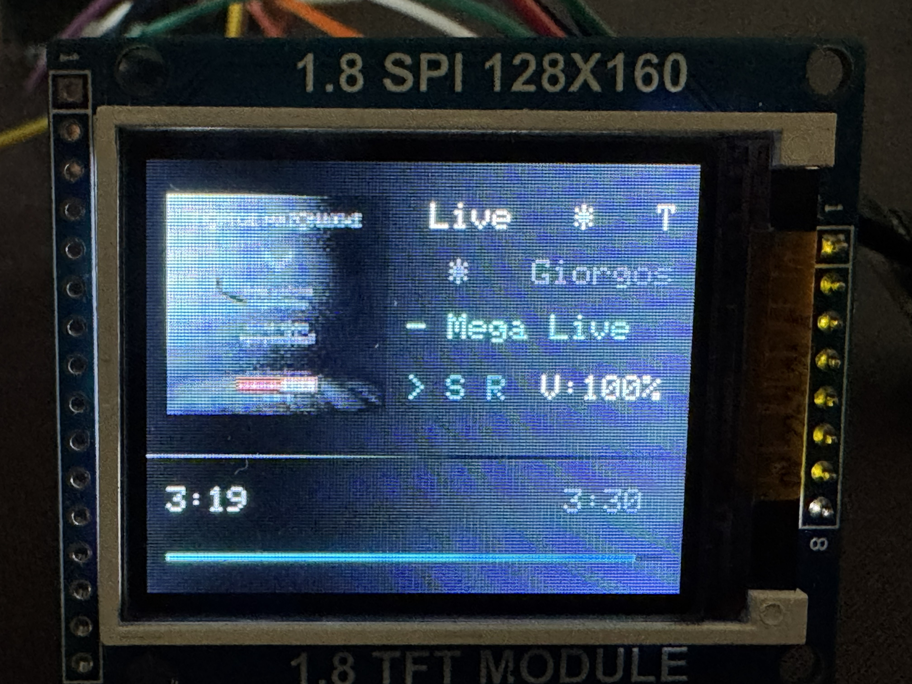
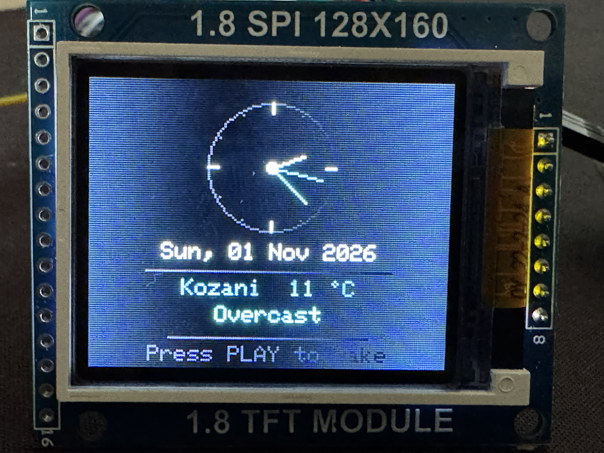

# 🎵 ESP32 Spotify Controller 

An interactive, physical Spotify desktop controller powered by an **ESP32**, a **1.8" ST7735 SPI TFT display**, an **EC11 rotary encoder**, and a **4-button module**.

Control your playback, browse your **Queue** and **Playlists**, adjust volume, view **64x64 album art**, and enjoy an analog clock & live weather **screensaver** when idle!

<p align="center">
  
</p>

<p align="center">
  &nbsp;&nbsp;
  
</p>

---

## ✨ Features

- **🎨 Color TFT Display (160x128):** Real-time playback status, progress bar, track timing, shuffle & repeat indicators.
- **🖼️ Album Art Rendering:** High-speed streaming and decompression of 64x64 JPEG cover art directly into display buffer using `TJpg_Decoder`.
- **📜 Smooth Marquee Scrolling:** Automatically scrolls long song titles, artist names, and album names.
- **📑 Interactive Menu System:**
  - **Queue Browser:** View the upcoming tracks in your queue and jump directly to any track.
  - **Playlists Browser:** Browse your library playlists and trigger playback with one click.
- **🎛️ Rotary Encoder Control:**
  - Rotate to adjust Spotify volume in real-time.
  - Press to Enter/Exit Menu or Confirm selections.
  - Rotate to navigate smoothly through menus.
- **🔘 Physical 4-Button Pad with Gestures:**
  - **K1 (PREV):** Single click skips to Previous track. **Long press (>700ms)** restarts current song from 0:00!
  - **K2 (PLAY):** Toggle Play / Pause. In menu, acts as "Back". In screensaver, wakes up display.
  - **K3 (NEXT):** Skip to Next track.
  - **K4 (SHUF):** Single click toggles Shuffle. **Long press (>700ms)** cycles Repeat mode (Off ➔ Context ➔ Track).
- **🕰️ Ambient Screensaver:**
  - Activates automatically after 45 seconds of idle / paused playback.
  - Smooth analog clock with second, minute, and hour hands.
  - Live date, location, and real-time weather & temperature fetched from Open-Meteo API (no API key required).

---

## 🛠️ Hardware Requirements (BOM)

| Component | Description | Example / Link |
| :--- | :--- | :--- |
| **Microcontroller** | ESP32 NodeMCU Development Board (30-pin) | ESP32-WROOM-32 |
| **Display** | 1.8" SPI TFT LCD (128x160, ST7735 controller) | ST7735 Red / Black PCB |
| **Rotary Encoder** | EC11 Rotary Encoder Module with Push Button | Keyes / KY-040 |
| **Keypad** | 4-Bit Key Button Module (Independent switches) | 4-key tactile module |
| **Power & Cables** | Micro-USB Cable & Breadboard / Jumper Wires | 5V / 1A minimum |

---

## 📌 Wiring Diagram / Pinout

### 1. 1.8" ST7735 SPI Display
| TFT Pin | ESP32 GPIO | Description |
| :--- | :--- | :--- |
| **GND** | GND | Ground |
| **VCC** | 5V (or 3.3V) | Power Supply |
| **SCL / CLK**| GPIO 18 | Hardware SPI Clock (VSPI) |
| **SDA / DIN**| GPIO 23 | Hardware SPI MOSI (VSPI) |
| **RES / RST**| GPIO 22 | Reset |
| **DC / A0** | GPIO 4 | Data / Command Control |
| **CS** | GPIO 5 | Chip Select |
| **BLK / LED**| 3.3V | Backlight Power |

### 2. EC11 Rotary Encoder
| Encoder Pin | ESP32 GPIO | Description |
| :--- | :--- | :--- |
| **CLK (A)** | GPIO 32 | Rotary Encoder Phase A |
| **DT (B)** | GPIO 33 | Rotary Encoder Phase B |
| **SW** | GPIO 25 | Push-button Switch |
| **+ (VCC)** | 3.3V | Power Supply |
| **GND** | GND | Ground |

### 3. 4-Bit Button Module
| Button Pin | ESP32 GPIO | Function |
| :--- | :--- | :--- |
| **K1** | GPIO 26 | **PREV** (Short: Prev Track \| Long: Restart Track) |
| **K2** | GPIO 27 | **PLAY** (Play/Pause \| Menu Back \| Wake up) |
| **K3** | GPIO 14 | **NEXT** (Next Track) |
| **K4** | GPIO 13 | **SHUF** (Short: Shuffle \| Long: Repeat Mode) |
| **GND** | GND | Common Ground |

---

## 💻 Software Prerequisites & Libraries

Install the following libraries using the **Arduino Library Manager** (`Sketch` ➔ `Include Library` ➔ `Manage Libraries...`):

1. **Adafruit ST7735 and ST7789 Library** (v1.10.x+)
2. **Adafruit GFX Library** (v1.11.x+)
3. **ArduinoJson** (v7.x recommended)
4. **TJpg_Decoder** (by Bodmer)

---

## 🚀 Quick Start Guide

### 1. Clone or Download the Repository
```bash
git clone https://github.com/YOUR_USERNAME/Esp_Spotify.git
cd Esp_Spotify
```

### 2. Configure Credentials
1. Copy `secrets.h.example` to `secrets.h`:
   ```bash
   cp secrets.h.example secrets.h
   ```
2. Open `secrets.h` in any text editor and fill in your Wi-Fi details and Spotify API keys:
   ```cpp
   #define SECRET_WIFI_SSID     "Your_WiFi_Network"
   #define SECRET_WIFI_PASSWORD "Your_WiFi_Password"

   #define SECRET_CLIENT_ID     "your_spotify_client_id"
   #define SECRET_CLIENT_SECRET "your_spotify_client_secret"
   #define SECRET_REFRESH_TOKEN "your_spotify_refresh_token"

   #define SECRET_CITY_NAME     "Athens" // Or leave "" for IP auto-detect
   ```

> [!NOTE]
> For a step-by-step walkthrough on how to register a Spotify Developer App and obtain your `REFRESH_TOKEN`, please consult [MANUAL.md](MANUAL.md).

### 3. Flash to ESP32
1. Open `Esp_Spotify.ino` in the Arduino IDE.
2. Select your board: **Tools ➔ Board ➔ ESP32 Dev Module**.
3. Select the COM port of your connected ESP32.
4. Click **Upload**.

---

## 🕹️ Controls Cheat Sheet

| Input | Normal Playback Mode | Menu Mode | Screensaver Mode |
| :--- | :--- | :--- | :--- |
| **Encoder Rotate** | Adjust Volume (0–100%) | Navigate Up / Down | — |
| **Encoder Click** | Open Main Menu | Select / Play Track | — |
| **K1 (PREV)** | Click: Previous Song<br>Hold: Restart from 0:00 | — | — |
| **K2 (PLAY)** | Toggle Play / Pause | Back to Main Menu / Exit | Wake up to UI |
| **K3 (NEXT)** | Next Song | — | — |
| **K4 (SHUF)** | Click: Toggle Shuffle<br>Hold: Cycle Repeat | — | — |

---

## 📖 Detailed Documentation
For in-depth guides covering hardware pinouts, troubleshooting common Spotify API errors, token generation, and firmware details, refer to:
- 👉 **[English User Manual (MANUAL.md)](MANUAL.md)**
- 👉 **[Ελληνικό Εγχειρίδιο Χρήσης (MANUAL_GR.md)](MANUAL_GR.md)**

---

## 📄 License
This project is licensed under the [MIT License](LICENSE).
Feel free to modify, customize, and share!
